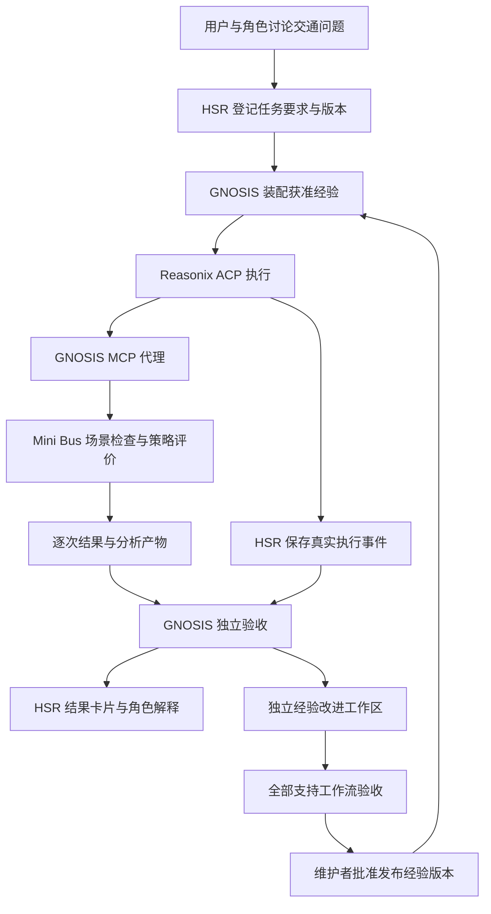

# GNOSIS 与 HSR 融合实施计划

日期：2026-10-14。状态：待实施。产品依据：[GNOSIS 产品 PRD v5.0](<E:/AI/GNOSIS Agent/docs/GNOSIS-产品PRD.md>)。HSR 当前代码版本为 v0.4.3；本文安排其后的融合工作，目标日期沿用 PRD，完成时间按实际执行登记。

## 1. 关键假设与架构决策

| 假设 | 当前依据与需要补齐的证据 | 撤掉假设，方案是否成立 |
| --- | --- | --- |
| HSR 可以提供完整任务上下文，并通过 ACP 注册真实交通工具 | 已核对 ACP 新建及恢复入口，两处均使用 `mcpServers=[]`；需要在打包 Reasonix 上跑通工具注册、调用和审批 | 直接融合的执行路径失效，必须先补齐 ACP 工具接入 |
| Mini Bus 的真实需求、站点图及两种已有策略具备共同评价条件 | 已读取评价规范；具体需求与模型资产需在首个任务中选定并实际运行 | 首个交通场景失效，先补齐数据和模型资产 |
| 交付要求可以关联到实际产物，并由独立评价核验 | PRD 已定义要求类型与评价条件；需要建立逐项要求到配置、逐次记录及报告的对应关系 | 任务验收职责失效，先完成任务与产物契约 |
| 用户重复开展相近分析，已验证经验可以改善后续任务 | 通过两周真实使用以及装载、撤除经验的共同条件比较取得证据 | 经验复用与订阅价值失效，任务验收能力仍成立 |

架构采用一个完整方案：HSR 管理任务生命周期与用户交互，GNOSIS Core 承担独立验收及经验版本管理，Mini Bus 提供业务工具与统一评价器。GNOSIS 接在委派执行前后，Reasonix 继续承担助手执行。首个交付必须贯通真实策略比较、产物核验、角色解释及后续任务的经验采用。

融合能力按绑定项目启用。项目登记工具包、评价器与获准经验版本；模型结合用户问题形成任务要求。后续 SMC 和 WindVanguard 沿同一任务契约接入，各自实现业务工具与评价器。

## 2. 用户任务与产品行为

首个任务：在绑定的 Mini Bus 项目中，给定一批真实出行需求，比较两种已有调度策略，输出可复核的指标表和图表，解释未服务请求的原因。

1. 用户向角色提出比较问题，角色结合项目资料形成结构化委派，明确策略、需求范围及交付要求。
2. HSR 保存任务版本和验收条件，装配对应项目的获准经验，将完整上下文交给助手。
3. Reasonix 经 MCP 调用场景检查、策略评价及产物生成工具。两侧使用共同需求和种子，采用相同终止规则与指标定义。
4. 工具返回实际生效配置、逐次结果及产物位置；执行事件进入 HSR 时间线和 GNOSIS 任务记录。
5. 助手回合结束后进入“验收中”。GNOSIS 独立读取对应产物，核对要求并重新计算关键汇总。
6. 验收通过后显示“已完成”，角色依据核验结果解释方案，用户打开报告及原始结果。验收失败时显示具体失败要求，角色据此形成修复委派。涉及用户新增决策时显示“待确认”。
7. 经任务证据形成的候选经验，在独立工作区完成全部支持工作流的验收，由维护者批准发布；下一次适用任务装载该版本。

桌面时间线增加任务要求卡片和验收结果卡片。每项要求展示完成状态及证据位置，结果卡片提供指标表、图表和原始记录入口。工具事件继续保持来源身份与结构化展示；角色自然语言解释沿用现有语音能力。

Mini Bus 地图关联对应任务的实际场景与服务分布，地图中的车辆状态和报告使用同一运行标识。移动端沿用配对能力，展示相同任务与验收状态，并通过已有受鉴权连接提供产物查看。

## 3. 代码基线与接入位置

以下现状来自 2026-10-14 的源码检查。实施时重新读取受影响文件。

| 模块 | 已核对的现状 | 实施改动 |
| --- | --- | --- |
| `src/pair_harness/adapters/acp/engine.py` | `open_session()` 的 `session/new` 与 `session/resume` 均传入空 MCP 服务列表；工具审批配置为 `ask` | 根据绑定项目传入同一工具服务配置，贯通新建、恢复、子进程重启及审批 |
| `src/pair_harness/core/orchestrator.py` | `_execute_once()` 从引擎终态形成 `ExecutionReceipt`，直接构造角色结果输入；修复重试依赖执行失败 | 在执行前登记要求与版本，执行中保存证据，执行后调用独立验收；将验收失败接入已有修复委派流程 |
| `src/pair_harness/core/contracts.py` | `TaskRequest`、`ToolRun`、`ExecutionReceipt` 和 `CharacterResultSummary` 已有任务与执行关联 | 扩展任务版本、要求和证据引用；分别保存执行、验收状态，将逐项结论传给角色 |
| `src/pair_harness/core/engine_state.py`、`storage/sqlite_store.py` | 已有执行生命周期与 SQLite 持久化 | 持久化验收过程、产物关联及经验版本，支持重启后恢复与旧数据迁移 |
| `src/pair_harness/desktop_backend/` | Sidecar 提供业务状态与 JSONL 事件 | 装配 GNOSIS 服务，投影任务和验收事件，提供受项目权限约束的产物访问 |
| `desktop/src/contracts/`、`presenters/`、`ui/workspace/` | 已有委派卡片、状态投影与工作台 | 扩展协议与界面，展示逐项要求、验收状态及产物；同步 `desktop/mobile/` |
| GNOSIS `engine/mcp_proxy.py` 与组件宿主 | 已有 MCP 转发、上下文工具和经验记录；每次工具调用刷新组件，上下文转换依赖研究适配器 | 增加产品消息适配及任务绑定，固定任务内版本；复用代理与组件宿主，接入交通任务 |
| GNOSIS `engine/evolution.py`、`activation.py` | 已有版本工作区、发布与冻结能力 | 接入交通任务的业务验收及经验采用记录，正式发布采用全部支持工作流重测 |
| Mini Bus `src/eval/evaluator.py`、`scripts/run_eval.py` | 提供统一指标及评价入口 | 封装真实评价调用、保存生效条件，补齐报告和未服务原因的产物契约 |

HSR 中建议新增 `src/pair_harness/adapters/gnosis/`，承载 Core 客户端与消息适配；核心契约和编排继续维护在 `core/`。交通算法及评价计算保留在 Mini Bus，经验引擎与候选发布保留在 GNOSIS。HSR 负责把三个项目的运行结果关联到一个用户任务。

## 4. 任务、证据与接口契约

### 4.1 一次任务的共同身份

HSR 分配 `task_id`，关联 `project_id`、`conversation_id` 和原始委派。用户修改需求、策略或评价条件时产生新的 `task_revision`。执行、工具调用及验收记录都引用对应版本，修复委派关联来源任务。

| 对象 | 必须保存的信息 |
| --- | --- |
| 任务要求 | 要求 ID、用户要求原文、模型整理的结构化条件、关联对象与预期证据；区分必要行动、保持事项和数值正确性 |
| 评价条件 | 需求与站点图标识、实际文件版本、两种策略及模型、生效配置、种子、终止规则、指标定义版本 |
| 版本绑定 | HSR、Reasonix、GNOSIS Core、Mini Bus 版本，以及获准经验版本和评价器版本 |
| 执行证据 | 实际模型输入、原始工具调用与结果、调用顺序、审批决定、命令退出状态、费用和运行时间 |
| 交付产物 | 项目内路径、产物类型、来源任务版本、对应要求及原始评价记录 |
| 验收记录 | 每项要求的结论、证据引用、重算结果、失败原因及原始错误 |
| 经验记录 | 来源任务、适用场景、版本、实际送达记录及后续工具行为；模型判断采用情况时引用行为证据 |

SQLite 保存任务及状态索引，产物保存在绑定项目的指定目录，GNOSIS 保存经验及版本验收记录。服务重启后依据持久化记录恢复；工具的实际执行状态由业务服务提供。证据仅保存获准业务内容，并保留原始消息字段；凭据通过现有配置通道传递，禁止写入任务记录、日志或产物。

### 4.2 执行状态与验收状态

`ExecutionReceipt` 保留引擎执行结果。新增独立验收记录，建议使用 `pending`、`running`、`passed`、`failed`、`needs_confirmation`；取消通过任务执行状态表达。界面由两份记录共同投影业务状态。

| 条件 | 用户看到的状态 | 后续动作 |
| --- | --- | --- |
| 助手仍在执行 | 执行中 | 持续展示真实工具事件 |
| 助手成功结束，核验尚在运行 | 验收中 | 独立读取产物并检查要求 |
| 全部要求满足，产物及关键汇总核验通过 | 已完成 | 将核验结果与证据交给角色 |
| 执行成功，交付要求或关键数值核验失败 | 验收失败 | 保存失败项，角色形成关联修复委派 |
| 工具或服务执行失败 | 执行失败 | 保存原始错误及已完成操作，按失败原因修复 |
| 需要用户新增决策 | 待确认 | 保存具体待决事项，收到答案后更新任务版本 |
| 用户取消 | 已取消 | 保存已发生的调用与产物，停止执行和验收 |

`end_turn` 表达助手执行结束。角色结果输入增加验收状态、逐项结论和证据位置；委派卡片的完成状态取自业务验收。验收失败复用现有一次修复重试安排，重试后重新验收并保留前后关联。

用户在执行期间提出新条件时，HSR 登记修订并交给助手。已有结果按其原任务版本保存，受影响步骤按新条件重新执行。每个任务版本固定产品及经验版本，服务发布的新经验供后续任务装载。

### 4.3 工具与 Core 接口

以下为待实现的接口职责，具体方法名在开发时与现有服务契约统一。

| 接口 | 输入 | 输出与责任 |
| --- | --- | --- |
| Mini Bus 场景检查 | 项目路径、真实需求、站点图、策略及模型引用 | 可执行条件、实际资产标识与真实缺失项 |
| Mini Bus 策略比较 | 已登记的共同评价条件、任务版本、产物目录 | 运行 ID、生效配置、逐次结果、汇总及未服务原因记录；长任务可查询和取消 |
| Mini Bus 产物生成 | 对应评价运行 ID、要求与报告目录 | 从真实结果生成指标表和图表，返回文件及来源引用 |
| GNOSIS 任务登记与上下文装配 | 完整委派、授权消息、任务版本及项目获准经验 | 任务记录、固定经验版本及实际送达的上下文 |
| GNOSIS 执行事件记录 | 任务与调用 ID、原始事件及产物关联 | 可追溯的执行证据与采用记录 |
| GNOSIS 独立验收 | 固定任务要求、执行证据、产物引用及评价条件 | 逐项结论、数值重算结果、证据位置与失败原因 |

HSR 显式提供上下文，适配器保留原始 tool call 与 tool result 字段。现有 `gnosis_build_context` 的模型续接请求由明确的模型调用职责处理，`continuation`、任务版本及实际送达结果关联保存。

验收由 HSR 发起，通过 Core 的受控接口运行；助手获得任务执行与经验使用工具。业务评价器和版本发布由独立权限维护。MCP 工具继续通过 HSR 沙箱及审批链路执行，具体路径和权限取自登记的项目及操作参数。

GNOSIS 代理实例按任务隔离，避免研究代理当前单任务状态在并发聊天中互相覆盖。任务启动时固定组件版本，后续调用使用相同版本。已有代理每次调用的刷新行为需要在产品适配中改为任务边界装载。

## 5. Mini Bus 的交付验收

评价依据为 [Mini Bus 评价规范](<D:/Documents/Bus Project/Mini Bus/Churn-Aware-GNN-RL/specs/eval_spec.md>)。先在真实数据上取得人工评价产物和操作耗时，再让 HSR 完成相同任务。

两种策略使用同一需求窗口、站点图及随机种子，记录实际生效的环境配置与终止规则。模型文件按策略登记，比较中完整保留这些条件。服务率与流失率使用评价器统一分母，`structural_unserviceable` 单独统计。

首任务登记服务率、等待时间及流失指标；依据业务问题同时输出 TACC 和服务分布指标。报告展示 `end_reason`、模拟时长及截断后的剩余请求。未服务原因引用实际请求状态及评价记录；缺失的原因证据作为交付失败项补齐。

独立验收从逐次结果重算汇总，核对报告中的数值和比较条件，数值容差按评价器精度在任务协议中声明。服务 Gini 使用全部 Layer-2 站点，包含零服务站点，采用规范中已有定义。

报告正文、表格和图表读取同一份验收后的结果。策略业务表现单独记录；任务完成率取决于分析工作与交付要求是否满足。策略结果较差仍可形成合格分析，角色解释依据该策略的真实业务指标。

## 6. 实施顺序与交付门槛

| 阶段与目标日期 | 开发任务 | 通过条件 |
| --- | --- | --- |
| M1：10 月 14 至 18 日 | 选定真实需求与两种策略，人工跑通共同条件评价；确定要求、产物及工具契约 | 两种策略实际运行成功，模型资产可用；保存原始结果、报告及人工操作耗时 |
| M2：10 月 19 至 25 日 | 封装 Mini Bus 工具，接入 ACP 新建和恢复会话；实现 GNOSIS 产品适配、任务登记和事件记录 | 两条会话路径均完成真实调用；审批可生效，完整委派与工具事件关联到正确任务版本 |
| M3：10 月 26 至 31 日 | 实现独立验收及修复委派，扩展 SQLite、Sidecar 和桌面界面；同步移动查看 | 从角色对话发起真实比较，产物核验通过，角色解释引用实际结果；重启后可恢复验收状态及产物关联 |
| M4：11 月 1 至 15 日 | 建立经验候选工作区及版本验收，验证实际送达、采用及跨场景收益 | 至少三个需求窗口或场景，包含业务例外，共同条件重复三次；关键业务错误为零，分歧结案，用户总耗时减少至少 30% |
| M5：11 月 16 至 30 日 | 完成 Windows 安装交付及团队试用，核算成本与报价 | 在用户环境安装后完整运行；两周内重复完成至少两次同类任务，至少一个团队真实付款，实际收费覆盖服务成本 |
| M6：12 月 | 固定工具及 Core 发布接口，在独立环境复现支持工作流；接入 SMC 校准及跨日验证 | 独立环境复现已声明能力，登记团队续用及实际毛利；SMC 使用自身评价器通过相同任务契约 |

M1 的真实评价产物决定工具封装和验收规则。M2 的核心契约确定后，后端、界面与业务工具可以并行开发；M3 完成产品闭环后，经验候选才能进入 M4 的正式比较。WindVanguard 按 PRD 次序接在 SMC 之后。

M1 的具体执行任务、评价条件与产物契约见 [M1 详细实施计划](GNOSIS-HSR-M1详细实施计划.md)。

日期为实施目标。阶段通过以表中的真实运行结果为准，缺少资产时补齐资产，工具错误按原始错误修复。

## 7. 经验发布与成本判断

候选经验关联来源任务，写清适用条件及采用后的可观察行为。分别记录经验登记、实际送达和后续采用，采用判断引用配置选择、工具调用或产物内容。项目经验与角色记忆按各自作用域维护。

候选与当前版本在相同初态下比较，固定模型、评价条件及重复次数。验收覆盖声明支持的全部工作流，纳入历史失败任务和业务例外。跨场景评价使用新的需求窗口或场景，同时比较装载、撤除同一经验的任务完成结果与完整成本。

发布要求为关键业务错误清零、历史能力通过、结果分歧结案，且任务完成率或用户总耗时有明确改善，完整成本处于试点约定范围内。维护者审批具体比较结果后发布；出现退化的候选保留在独立工作区，正式任务使用已验收版本。

每个验收通过任务的完整成本按 PRD 计算：全部执行支出，加复核返工、适配分摊及版本验收分摊，再除以验收通过的任务数。失败任务支出进入总额，用户自配账号费用按实际承担方记录。工具失败数与执行步数用于定位效率问题，收费判断采用用户耗时及完整成本。

试点目标为用户总耗时减少至少 30%，两周内重复使用并产生真实付款。团队服务毛利目标为 60%，实际收入与服务成本决定结果。未达到耗时改善目标时定位具体环节；复核返工抵消收益时结束该工作流收费试点，购买者拒付时按拒付原因重新裁决收费对象。

## 8. 验证与安装交付

实施验证覆盖真实 ACP 新建及恢复会话、审批、共同条件评价、独立验收及角色解释。继续检查真实任务中的修订、取消和服务重启；验证结果保存到对应任务记录。工具执行失败保持原始失败状态，修复后针对受影响任务重新运行。

代码改动后运行对应项目的标准检查。HSR Python 在仓库根执行 `.\.venv\Scripts\python.exe -m pytest -q`；前端在 `desktop/` 执行 `npm test -- --run`、`npm run typecheck` 和 `npm run build`。涉及 Rust 时在 `desktop/src-tauri/` 执行 `cargo test`。移动端改动运行其 `package.json` 中的检查与构建命令，GNOSIS 和 Mini Bus 按各自仓库标准命令验证。

Windows 安装交付需要打入 GNOSIS Core 及工具服务启动依赖，登记各组件版本；Mini Bus 在绑定项目的运行环境中执行。打包沿用 `build:sidecar` 与 Tauri NSIS 流程，经 `desktop/scripts/tauri-with-first-run-reset.ps1` 完成首次运行数据清理。清理后从新人首次进入的状态配置项目，完整运行首个交通任务。

Android 交付沿用现有移动构建脚本与版本派生规则，安装到真机后验证配对、任务状态及产物查看。发布安装包与经验版本时，由维护者批准已完成验证的具体成果。

## 9. 开发启动点

第一项执行工作是选定 Mini Bus 的真实需求窗口、站点图与两种可运行策略，在共同条件下取得人工评价结果。随后完成任务与产物契约，接入 ACP 工具服务，再贯通独立验收和角色结果轮。

GNOSIS 的科研材料与同源实验按独立协议推进；研究候选通过上述交通工作流验收后进入产品。融合开发的下一步由 M1 的真实运行结果决定。
